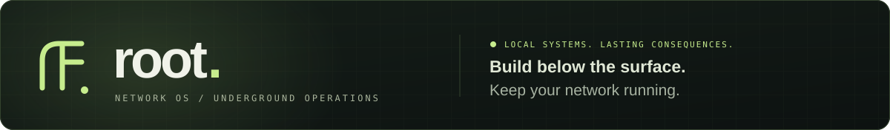
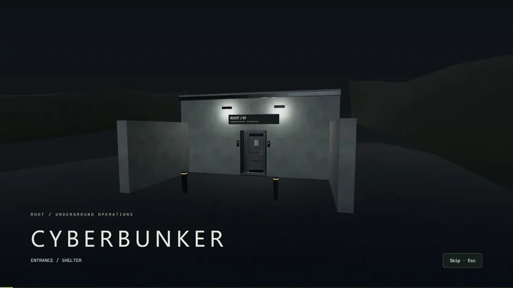
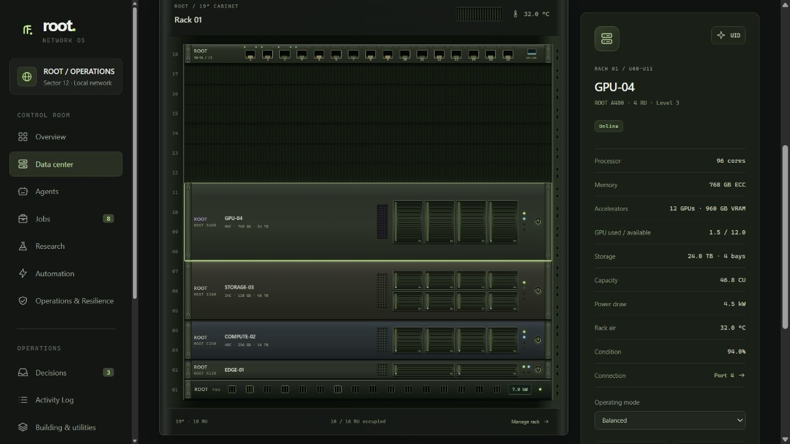
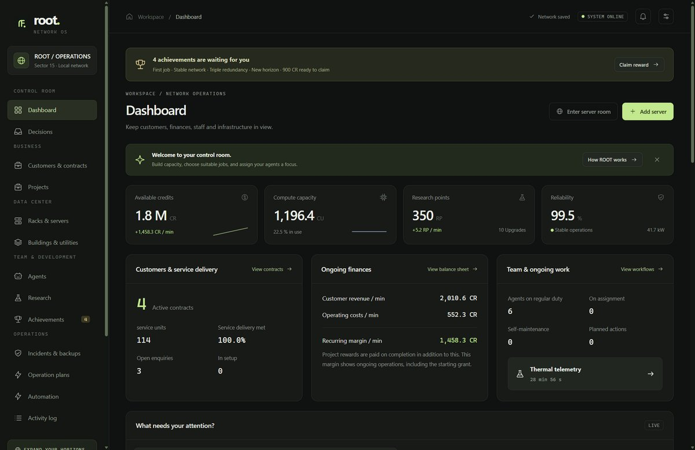
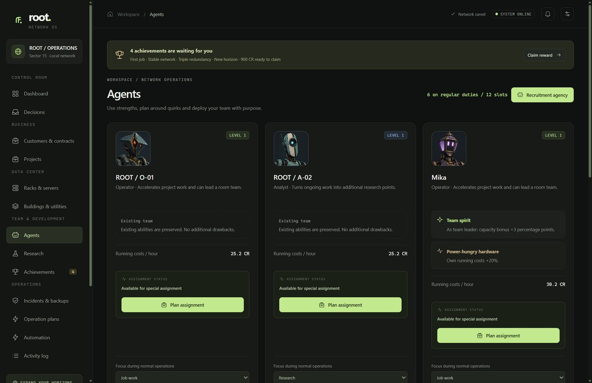
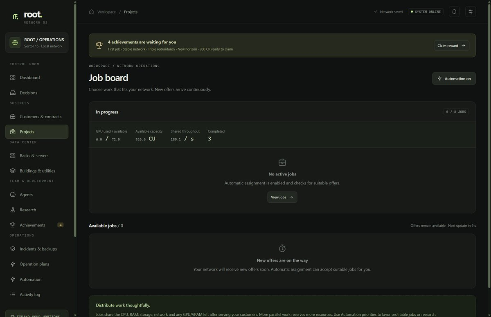
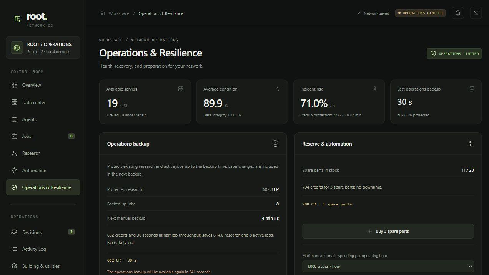
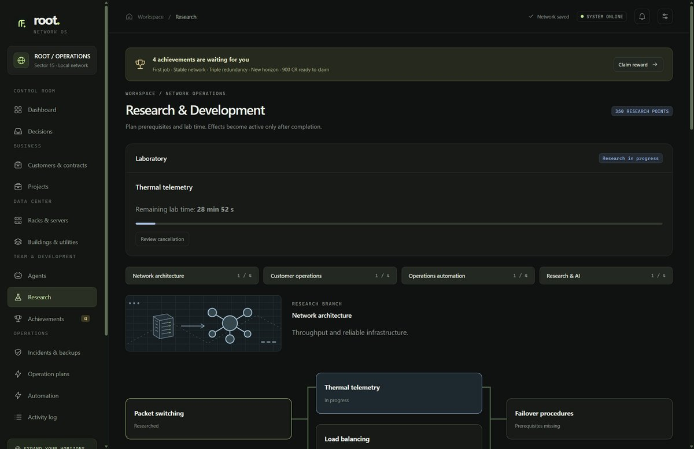
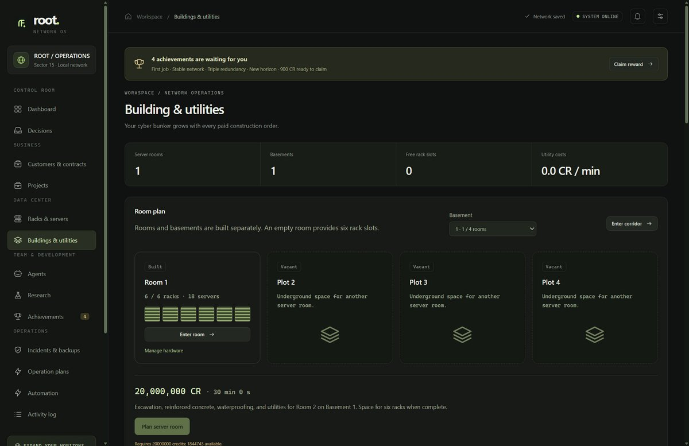
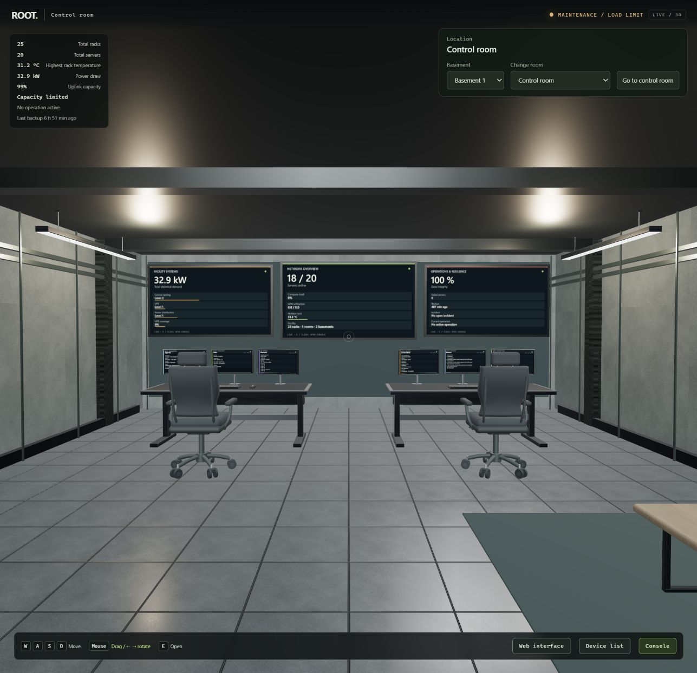

[](https://github.com/Tricade/root-network-os/actions/workflows/ci.yml)
[](package.json)
[](LICENSE)
[](AI-DISCLOSURE.md)
[](https://ko-fi.com/tricade)
[](https://github.com/Tricade/root-network-os/stargazers)

<p align="center">
  
</p>

<p align="center">
  <strong>Ein Infrastruktur-Management-Simulator in einem wachsenden unterirdischen Rechenzentrum.</strong><br>
  Baue die Hardware aus. Gib deinen Agenten einen Plan. Triff die Entscheidungen, die deine Automatik nicht übernehmen kann.
</p>

> [!IMPORTANT]
> **KI-Transparenz:** Generative KI hat Code, Tests, Dokumentation, Übersetzungen und prozedurale Assets von ROOT wesentlich unterstützt. Änderungen benötigen weiterhin Prüfung, passende Tests und nachvollziehbare Asset-Herkunft. Anwendung und lokale Assetgeneratoren kontaktieren keinen KI-Anbieter. [AI-DISCLOSURE.md](AI-DISCLOSURE.md) beschreibt Umfang und Prüfgrenzen, [NOTICE.md](NOTICE.md) die komponentenbezogenen Lizenzen.

Dir gefällt ROOT? **Gib dem Repository einen ⭐ [Stern auf GitHub](https://github.com/Tricade/root-network-os)**, damit andere es leichter entdecken.

<p align="center">
  <a href="README.md">English</a> · <a href="#start">Schnellstart</a> · <a href="#console">Screenshots</a> · <a href="#features">Features</a> · <a href="CONTRIBUTING.md">Mitbauen</a> · <a href="https://ko-fi.com/tricade">Ko-fi</a>
</p>

<p align="center">
  <picture>
    <source media="(prefers-reduced-motion: reduce)" srcset="screenshots/readme/arrival-poster.jpg">
    
  </picture>
  <br><sub>Aus der laufenden Anwendung aufgenommen. <a href="screenshots/readme/arrival-poster.jpg">Standbild öffnen</a> · <a href="screenshots/readme/README.md">Hinweise zu den Aufnahmen</a></sub>
</p>

<p align="center">
  <a href="AI-DISCLOSURE.md"></a>
</p>

## Vom ersten Rack zum Cyberbunker

Du beginnst mit **einem Rack, einem Edge-Server, zwei Agenten und einem Serverraum**. Nimm Aufträge an, verdiene Credits und Forschungspunkte und entscheide, welcher Ausbau gerade wirklich hilft. Ein schnellerer Server kann die Kühlung zum Engpass machen. Ein weiterer KI-Auftrag kann die letzten freien GPUs belegen. Ein Forschungsauftrag für deinen besten Analysten entzieht dem normalen Betrieb einen Spezialisten.

ROOT ist für **gelegentliches Reinschauen** gedacht. Stelle Auftragsprioritäten ein, reserviere Geld für Wartung und lege Betriebsbackups an. Beim Wiederkommen siehst du, was inzwischen fertig geworden ist. Große Vorfälle begrenzen weitere Schäden und warten auf deine Entscheidung. Bis zu **zwölf Stunden Abwesenheit** werden beim Zurückkehren nachgerechnet; der Browser muss dafür nicht geöffnet bleiben.

Verwalte alles über die **Weboberfläche**, oder gehe in **Ego-Perspektive** durch die Anlage und bediene Racks, Terminals und Wandmonitore. Beide Oberflächen arbeiten mit demselben Netzwerk und demselben Fortschritt. Der Ausbau bleibt offen: Neue Sektoren, wiederholbare Forschung und weitere Bauprojekte treten an die Stelle eines festgelegten Kampagnenendes.

| Aufbauen                                                        | Betreiben                                           | Absichern                                                                | Erweitern                                                     |
| :-------------------------------------------------------------- | :-------------------------------------------------- | :----------------------------------------------------------------------- | :------------------------------------------------------------ |
| Server in Höheneinheiten einbauen, Ports und Strom anschließen. | Aufträge, GPU-Bedarf und Agenteneinsätze abstimmen. | Reparaturkosten, Ausfallzeit, Ersatzteile und Wiederherstellung abwägen. | Forschen und neue unterirdische Räume und Etagen finanzieren. |

<a name="console"></a>

## Die Weboberfläche

Auch die physische Infrastruktur lässt sich vollständig in der normalen Oberfläche verwalten: Gerätespezifikationen, GPU-Auslastung, Switch-Ports, Verkabelung, Stromprofile und die Folgen von Ausbauten sind direkt zugänglich.

[](screenshots/readme/hardware-full.jpg)

<table>
  <tr>
    <td width="50%"><a href="screenshots/readme/overview.jpg"></a><br><strong>Netzwerkübersicht</strong><br>Einnahmen, Kapazität, Forschung, Zuverlässigkeit, Entscheidungen und aktuelle Infrastruktur.</td>
    <td width="50%"><a href="screenshots/readme/agents.jpg"></a><br><strong>Agenten und Einsätze</strong><br>Spezialisten entwickeln, Schwerpunkte setzen und entscheiden, wer im Betrieb fehlen darf.</td>
  </tr>
  <tr>
    <td><a href="screenshots/readme/jobs.jpg"></a><br><strong>Kundenaufträge</strong><br>Vergütung, Forschung, Auslastung und benötigte GPUs vor der Annahme vergleichen.</td>
    <td><a href="screenshots/readme/resilience-full.jpg"></a><br><strong>Betrieb und Schutz</strong><br>Defekte, Reparaturen, Ersatzteile, geschützte Geldreserven und Betriebsbackups verwalten.</td>
  </tr>
  <tr>
    <td><a href="screenshots/readme/research.jpg"></a><br><strong>Forschung und Meilensteine</strong><br>Die gesamte Flotte verbessern und Erfolgsbelohnungen abholen.</td>
    <td><a href="screenshots/readme/construction-full.jpg"></a><br><strong>Gebäude und Technik</strong><br>Flächen kaufen, Baufortschritt verfolgen und Kühlung, USV und Stromverteilung planen.</td>
  </tr>
</table>

_Echte Aufnahmen mit einem getrennten, synthetischen Demostand und englischer Oberfläche. Ein Klick öffnet die größere Ansicht. Die Anwendung ist auf Deutsch und Englisch umstellbar._

<a name="features"></a>

## Was du steuern kannst

### Hardware, Verkabelung und KI-Aufträge

- **Vier Gerätefamilien:** Edge-, Rechen-, Speicher- und KI-Server unterscheiden sich bei Platzbedarf, Kapazität, Strom und Netzwerklast.
- **Physischer Einbau:** Ein 18U-Betriebsrack bietet 16 Höheneinheiten für Geräte sowie Switch und Stromverteilung. Wähle zusammenhängende Einbauplätze, patche Server um und verteile dichte Hardware auf mehrere Racks.
- **Wirksame Engpässe:** Strombudget, Kühlung, Switch, Uplink und einzelne Portzustände begrenzen die nutzbare Leistung. Ein getrennter Netzwerkport lässt den Server eingeschaltet, aber ohne Kapazitätsbeitrag.
- **Simulierte KI-Infrastruktur:** Der ROOT A480 belegt in der Grundausstattung 4U und liefert vier simulierte Beschleuniger mit 320 GB VRAM. Inferenz- und Trainingsaufträge brauchen GPU-Kapazität; freie CPU-Leistung ersetzt sie nicht.
- **Eingriffe mit Folgen:** Ausgewogen, Leistung und Öko tauschen Durchsatz gegen Strom und Wärme. Neustarts und Umpatchen dauern; Rackausbauten unterbrechen die angeschlossene Hardware vorübergehend. Kühlung verändert Temperaturen allmählich.

### Agenten, Aufträge und Forschung

- **Drei Rollen:** Operatoren unterstützen Aufträge und Einnahmen, Analysten liefern Forschung, Techniker helfen bei Wartung und Zuverlässigkeit. Agenten haben Stufen, Eigenschaften und einen einstellbaren Schwerpunkt.
- **Gezielte Einsätze:** Netzdiagnose senkt das Risiko, Lastoptimierung erhöht den Durchsatz und Forschungsaufträge liefern Punkte. Während eines Einsatzes fehlt der Agent vollständig im Normalbetrieb. Die Wirkung beginnt nach Abschluss; anschließend gilt eine Erholungszeit. Passende Rollen arbeiten bei ihren Spezialaufgaben effizienter.
- **Konkurrierende Kundenaufträge:** Monitoring, Migration, Audits, Optimierung, Wiederherstellung, Forschung und KI-Arbeit teilen sich begrenzte Kapazitäten. Credits, Ansehen und Forschung werden bei Abschluss vergeben. Die automatische Annahme kann ausgewogen, auf Einnahmen oder auf Forschung ausgerichtet werden.
- **Fünf wiederholbare Forschungszweige:** Routing, Kühlung, Vertragsanalyse, effiziente Abläufe und Wissenssynthese verbessern das gesamte Netzwerk. Erfolgsbelohnungen werden separat abgeholt.
- **Entscheidungen und Sektoren:** Optionale Ereignisse bieten verschiedene Vorteile und warten ohne Zeitlimit; bis zu drei können gleichzeitig offen sein. Neue Sektoren verlangen Credits und Betriebsmeilensteine und eröffnen weitere Entwicklung. Räume entstehen dadurch nicht kostenlos.

### Defekte, Reparaturen und Backups

- **Verschleiß und Ausfälle:** Zustand, Wärme und Betriebsrisiko können Server ausfallen lassen und den Auftragsdurchsatz senken.
- **Reparaturentscheidungen:** Schnellreparatur, Generalüberholung und langsame Notfallwiederherstellung unterscheiden sich bei Geld, Ersatzteilen, Ausfallzeit, Endzustand und Arbeitsverlust. Ein Neustart oder ein anderer Port behebt keinen Hardwaredefekt. Die manuelle Wiederherstellung bietet einen langsamen Ausweg ohne Credits oder Ersatzteile, kostet dafür aber Arbeitsfortschritt und erreicht nur einen eingeschränkten Endzustand.
- **Große Vorfälle:** Stromausfälle, Kühlungsausfälle und Datenkorruption verlangen eine bewusste Wiederherstellungsentscheidung. Der Schutzmodus begrenzt weitere Schäden während der Abwesenheit. Betroffene Aufträge und Agenteneinsätze pausieren bis zur Wiederherstellung.
- **Betriebsbackups:** Schützen Forschung und laufende Auftragsarbeit vor Datenkorruption. Eine Rücksicherung kann Fortschritt seit dem Sicherungszeitpunkt kosten. Sie ist etwas anderes als der Export des vollständigen Speicherstands.
- **Begrenzte Automatik:** Automatische kleinere Reparaturen benötigen Ersatzteile. Reparaturen und Betriebsbackups beachten ein stündliches Ausgabenlimit und die geschützte Geldreserve. Die Routine läuft selbstständig; größere Wiederherstellungsentscheidungen bleiben relevant. [Automatisierungsansicht öffnen →](screenshots/readme/automation.jpg)

### Kostenpflichtiger Ausbau unter der Erde

Aushub ist eine große Investition. Ein neues Netzwerk besitzt **einen Serverraum und den zugehörigen Flur**. Jeder weitere Serverraum, jedes Untergeschoss sowie Kontroll- und Technikräume müssen einzeln bezahlt und gebaut werden.

| Bauprojekt             |      Anfangskosten | Anfängliche Bauzeit | Verfügbare Fläche                            |
| :--------------------- | -----------------: | ------------------: | :------------------------------------------- |
| Nächster Serverraum    |  **20.000.000 CR** |          **30 min** | Sechs Rackplätze auf einer vorhandenen Etage |
| Nächstes Untergeschoss | **500.000.000 CR** |             **2 h** | Flur, Treppen und vier freie Raumbauplätze   |
| Kontrollraum           |      20.000.000 CR |              30 min | Leitstelle, ab Sektor 2                      |
| Klimaraum              |      25.000.000 CR |              30 min | Platz für zentrale Kühlung, ab Sektor 4      |
| USV-Raum               |      30.000.000 CR |              30 min | Platz für zentrale USV, ab Sektor 6          |
| Stromverteilungsraum   |      35.000.000 CR |              30 min | Platz für zentrale Verteilung, ab Sektor 8   |

**Am Anfang bezahlen, nach Fertigstellung nutzen.** Mit dem Ausbau steigen Preise und Bauzeiten für Räume und Etagen. Ein Bautrupp bearbeitet jeweils ein Projekt; der vorhandene Betrieb, Backups und Notfallreparaturen bleiben verfügbar. Racks, Server und zentrale Anlagen werden separat installiert. Der Kontrollraum enthält seine Einrichtung. Bauaufträge lassen sich derzeit nicht abbrechen oder erstatten.

Kontroll- und Technikflügel werden einmalig auf Untergeschoss 1 gebaut. Zentrale Anlagen unterstützen die aktiven Racks der gesamten Einrichtung. Ein Serverraum fasst **sechs Racks**, ein Untergeschoss bietet **vier Serverraumbauplätze**. Zentrale Kühlung, USV und Stromverteilung haben endliche, ausbaubare Kapazitäten und laufende Kosten. Der USV-Schutz hängt von der tatsächlich abgedeckten Last ab. Bestehende Speicherstände behalten ihre zuvor zugänglichen Räume und Geräte. [Bauregeln und Wirtschaft im Detail →](docs/construction.md)

## Durch die Infrastruktur gehen

Verbindungsflure, Treppen zwischen angrenzenden Etagen, Server- und Technikräume sowie der eingerichtete Kontrollraum sind begehbar. Die Wandmonitore zeigen aktuelle Betriebswerte. Öffne zuerst die Racktür, um an die Hardware zu gelangen. Terminals öffnen dieselben Verwaltungsfunktionen wie die Weboberfläche; Kosten und Konsequenzen werden vor dem Start einer Maßnahme angezeigt.

<details>
<summary><strong>Kontrollraum und Ego-Steuerung ansehen</strong></summary>



| Steuerung                                  | Funktion                                                            |
| :----------------------------------------- | :------------------------------------------------------------------ |
| WASD                                       | Bewegen                                                             |
| Maus ziehen / Pfeiltasten links und rechts | Umsehen                                                             |
| E am geschlossenen Rack                    | Tür öffnen                                                          |
| E an freiliegender Hardware                | Geräteverwaltung öffnen                                             |
| E an Tür oder Terminal                     | Ziel bedienen                                                       |
| Escape                                     | Zuerst Dialog oder Konsole schließen, danach den Rundgang verlassen |
| Raum- und Etagenauswahl                    | Ohne Laufweg direkt wechseln                                        |

Raumtüren sind von beiden Seiten bedienbar und schließen nach dem Durchgehen. Ohne Mausbindung bleibt das Ziehen mit der Maus verfügbar. Nach F5 werden Ort und gespeicherte Ego-Position innerhalb des Browser-Tabs wiederhergestellt. Die überspringbare Einfahrt lässt sich in den Einstellungen wiederholen oder deaktivieren; reduzierte Animationen werden berücksichtigt.

</details>

<a name="start"></a>

## Schnellstart

### Desktop herunterladen

[**ROOT für Windows oder Linux herunterladen →**](https://github.com/Tricade/root-network-os/releases/latest)

| Windows x64                            | Linux x64                               |
| -------------------------------------- | --------------------------------------- |
| NSIS-Installer mit eingebautem Updater | DEB-Paket mit eingebautem Updater       |
| Portable EXE mit manuellen Updates     | Portable AppImage mit manuellen Updates |

Node.js muss dafür nicht separat installiert werden. Portable speichert im benachbarten `ROOT-data`-Ordner; behalte ihn beim Austausch der Anwendung. Installierte Ausgaben bieten **Einstellungen → Desktop & Updates** zum Prüfen, Herunterladen und Installieren nach bestätigtem Speichern. Die Vorschaupakete sind unsigniert. AppImage benötigt FUSE und erlaubte Chromium-Sandbox/Benutzernamensräume. [Einrichtung, Fortschritt übernehmen und Update-Details →](docs/desktop.md)

### Lokal im Browser

Benötigt wird **Node.js 24**, geprüft mit **24.22.1**. Repository klonen oder herunterladen und im Ordner starten:

```sh
node server.cjs
```

Danach **[127.0.0.1:18473](http://127.0.0.1:18473/)** öffnen. Unter Windows kannst du **ROOT starten.cmd** doppelklicken, sobald Node im `PATH` verfügbar ist.

**Zum Starten sind keine Paketinstallation, kein Build, kein Konto und keine Internetverbindung nötig.** Three.js und die Laufzeit-Assets liegen bei. Unter **Einstellungen → Sprache / Language** wechselst du zwischen Deutsch und Englisch. Separate Ports und Datenordner erklärt die [Anleitung zum Mitbauen](CONTRIBUTING.md).

### Der erste Betrieb

1. Rack ansehen und Aufträge annehmen, die zur vorhandenen Kapazität passen.
2. Agentenschwerpunkte einstellen und den aktuellen Engpass vor einem Ausbau prüfen.
3. Automatische Auftragsannahme, Wartungsausgaben und Geldreserve konfigurieren.
4. Ein Betriebsbackup anlegen sowie Geld und Ersatzteile für Reparaturen vorhalten.
5. Forschen, Sektormeilensteine erfüllen und auf unterirdische Erweiterungen sparen.

## Lokal speichern und gelegentlich zurückkommen

- Automatisches Speichern alle 15 Sekunden und nach Entscheidungen. Im Browser-Modus enthält `data/save.json` den aktuellen Stand und `data/save.backup.json` die vorherige gültige Speicherung. Desktop nutzt den oben beschriebenen eigenen Speicherordner.
- JSON-Export und -Import umfassen das komplette Netzwerk. Unterstützte Speicherstände der Versionen 1 bis 3 lassen sich importieren. Vor dem Wechsel auf ältere Versionen exportieren.
- Beim Zurückkehren werden bis zu **zwölf Stunden** nachgerechnet, einschließlich Arbeit, Einnahmen, Wartung und Baufortschritt. Längere Abwesenheit wird begrenzt. Die Berechnung erfolgt im Client; auf dem Server läuft keine dauerhafte Wirtschaftssimulation.
- Widersprüchliche Sitzungen überschreiben neueren Fortschritt nicht stillschweigend. Eine veraltete Sitzung pausiert; ihre abweichende Browserkopie bleibt exportierbar.
- Der Dienst bindet nur an Loopback. Es gibt **keine Telemetrie, Analyse-Dienste oder Online-KI-Aufrufe**. Installierte Ausgaben können optional GitHub auf Updates prüfen; Simulation, Browser-Modus und Portable funktionieren offline. Hardware, Agenten und KI-Aufträge werden simuliert; ROOT trainiert keine Modelle auf deinem Rechner. Optionale Unterstützungslinks führen zu externen Webseiten. [Sicherheits- und Bereitstellungsgrenzen →](SECURITY.md)

<details>
<summary><strong>Vorschaustatus, technische Grenzen und Prüfungen</strong></summary>

ROOT ist eine laufend entwickelte **Vorschau 1.5.1**. Balancing, Übersetzung, Barrierefreiheit und 3D-Darstellung freuen sich über Beiträge. Der Ausbau endet nicht nach sechs Racks. Die Datenprüfung akzeptiert derzeit bis zu 10.000 Racks, 10.000 Server und 1.000.000 Sektoren sowie fünf Stufen zentraler Anlagen. Nur der ausgewählte Raum wird gerendert. Eine erfolgreiche Datenprüfung am Maximum belegt keine gute Echtzeit-Performance bei dieser Größe.

[Integrationsprüfung](docs/verification-construction.md), [Laufzeit-Hinweise](docs/runtime-1.4.md) und [Asset-Prüfungen](docs/asset-audit.md) dokumentieren Nachweise und Grenzen. Die Desktop-Paketprüfungen ergänzen die früheren Nachweise der Version 1.4; siehe [Prüfumfang und Grenzen](docs/desktop.md).

</details>

## Mitbauen

Du kannst mit Fehlerberichten, Balancing-Versuchen, Übersetzungen, Barrierefreiheit, eigenen 3D-Assets oder Code helfen. Programmieren ist keine Voraussetzung für einen Beitrag.

- **Ein Problem gefunden?** [Fehler melden](https://github.com/Tricade/root-network-os/issues/new?template=bug_report.yml), mit Version, Reproduktionsschritten und einem synthetischen Beispiel.
- **Eine Idee?** [Feature vorschlagen](https://github.com/Tricade/root-network-os/issues/new?template=feature_request.yml) und erklären, welches Problem es lösen und wie es sich verhalten soll.
- **Selbst mitbauen?** [CONTRIBUTING.md](CONTRIBUTING.md) erklärt Fork, getrennte Entwicklungsinstanz und einen gezielten Pull Request gegen `main`. Größere Änderungen lassen sich vorher gut in einem Issue besprechen.

```sh
npm ci --ignore-scripts
npm run check
```

Dabei laufen Linter, Formatprüfung und Node-Tests. Verwende synthetische Speicherstände und Screenshots. Persönlicher Fortschritt und Zugangsdaten gehören nicht in Commits. [Beitragsleitfaden →](CONTRIBUTING.md) · [Architektur →](docs/development.md) · [GitHub-Umzug →](docs/publishing.md)

### Das Asset-Werkzeug ist enthalten

Bearbeitbare glTF-Quellen und lokale Generatoren für die gelieferten Basismodelle, zentrale Anlagentechnik und die eigene Kontrollraumeinrichtung liegen im Repository. Neue Ausgaben entstehen in einem frischen `.asset-build/`-Verzeichnis und überschreiben das gepflegte Laufzeitpaket nicht.

```sh
node tools/asset-generator/generate.mjs --help
node tools/asset-generator/generate.mjs interiors
```

Basis- und Anlagengenerator verwenden optional Python; der normale Betrieb und die eigene Möbelgenerierung benötigen nur Node. [Asset-Werkzeug, Abhängigkeiten und Herkunft →](tools/asset-generator/README.md)

## Unterstützen und Transparenz

<a href="https://ko-fi.com/tricade"></a>

Wenn dir ROOT gefällt, helfen Unterstützung, ein guter Fehlerbericht oder ein eigener Beitrag bei der Weiterentwicklung.

**Generative KI hat Entwicklung, Dokumentation und prozedurale Assets wesentlich unterstützt.** Die Anwendung kontaktiert im Betrieb keinen KI-Anbieter. Der [KI-Hinweis](AI-DISCLOSURE.md) beschreibt Umfang und Prüfgrenzen.

Der Programmcode steht unter der [MIT-Lizenz](LICENSE). Eigene generierte Modelle und Texturen verwenden CC0-1.0; gelieferte Assets, Materialtexturen und das mitgelieferte Three.js haben komponentenspezifische Hinweise. Vor der Weiterverwendung einzelner Bestandteile bitte [NOTICE.md](NOTICE.md) und das [Asset-Verzeichnis](asset-pack/docs/runtime_inventory.json) beachten.
